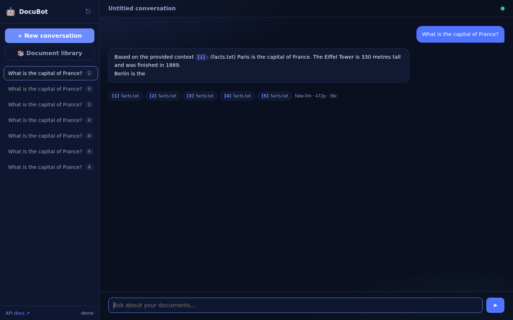
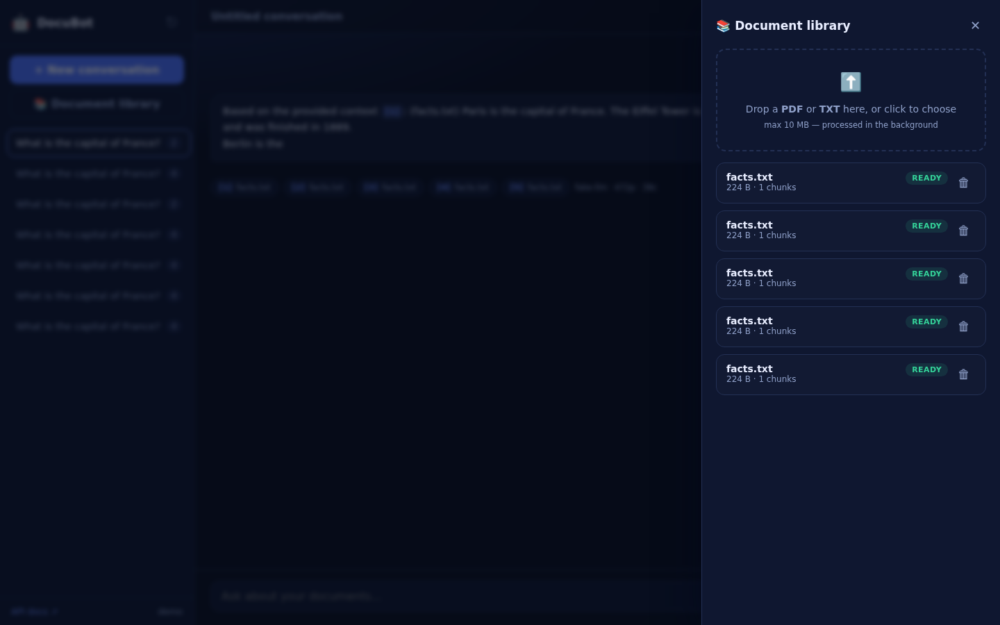

# 🤖 DocuBot

**A production-grade RAG knowledge-base backend — upload documents, get streaming answers with page-level citations.**

DocuBot is a Django REST backend that turns uploaded PDFs and text files into a
searchable knowledge base. Documents are processed asynchronously (extract →
chunk → embed, page-aware) and stored in PostgreSQL with **pgvector**. Answers
come from a **hybrid retrieval engine** (embeddings + Postgres full-text search,
fused with Reciprocal Rank Fusion), streamed token-by-token over **SSE**, with
clickable `[n]` citations that resolve to document and page. A zero-build
**demo UI** ships in the box so you can watch it work.


| Chat with streaming answers and citations | Document library with live processing status |
| --- | --- |
|  |  |

## Why this project is different

Most RAG demos stop at a notebook. DocuBot is the parts that come *after* the
notebook, done properly:

- **Idempotent async pipeline.** Upload → Celery → extract → chunk → embed, with
  `acks_late`, a claim step, stale-claim recovery and retry/backoff — a crashed
  worker loses nothing, and re-running a task never duplicates chunks.
- **Multi-tenant by construction.** Every queryset and both retrieval signals
  are owner-scoped in SQL; another user's id 404s like a nonexistent one.
- **Hybrid retrieval, not just vectors.** Embeddings catch meaning, a generated
  `tsvector` column with a GIN index catches literal terms (error codes, part
  numbers, names), and Reciprocal Rank Fusion merges both rankings into one —
  chunks found by *both* signals float to the top. Pick the signal per request:
  `mode: vector | keyword | hybrid`.
- **Citations you can verify.** The model must tag claims with `[n]`; the API
  resolves those markers back to real sources and returns them as a structured
  `citations` list with document id and **page number** (chunks remember the
  PDF page they came from). A marker with no source behind it is dropped, so
  the API can never cite a document that was not in the context.
- **Conversational memory that actually searches well.** Follow-ups like
  *“and the second one?”* are rewritten into a standalone query using the
  recent turns before retrieval — best effort, with graceful fallback.
- **Streaming answers.** `POST /messages/stream/` emits Server-Sent Events —
  `sources`, then `delta` tokens, then `done` (with token usage and resolved
  citations) — while still persisting the turn.
- **Feedback loop.** Thumbs up/down (+ optional comment) on every answer, from
  the API or one click in the demo UI — the raw material for evals and
  reranking later.
- **Provider-agnostic AI layer.** Embeddings and LLMs sit behind small
  abstractions with three implementations each (local/fastembed, any
  OpenAI-compatible endpoint, Anthropic) plus deterministic fakes that let the
  whole system run offline with zero API keys.
- **Hardened edges.** Scoped rate limits on auth/chat/search/uploads, JWT with
  rotation + blacklist, content-based upload validation, prompt-injection
  mitigation and enforced source citations.
- **298 tests, 94% coverage, ruff-clean** — and CI that runs the suite against
  a real pgvector/Redis service.

## Architecture

```
                        ┌──────────────────────────────────────────────────────┐
                        │                    Docker network                    │
   upload (PDF/TXT)     │   ┌───────┐  enqueue   ┌────────┐   extract/chunk     │
┌───────────────┐  POST │   │ Redis │◄───────────┤  Celery├───┐ embed (fastembed)│
│      web      ├───────┼──►│ broker│            │ worker │   │ ▼                │
│ Django + DRF  │       │   └───────┘            └────────┘   │ PostgreSQL 16    │
│  - JWT auth   │  ask  │   ┌───────┐   cache                  │ - documents      │
│  - rate limit ├───────┼──►│ cache │◄─────────────────────────┤ - chunks         │
│  - SSE stream │       │   └───────┘                          │   vector(384)    │
└───────────────┘       │                                      │   + HNSW index   │
   /demo/ UI            │                                      └──────────────────┘
                        └──────────────────────────────────────────────────────┘
```

**Document pipeline:** `pending → processing → ready | failed`, with
`POST /documents/{id}/reprocess/` for failed docs (e.g. scanned PDFs with no
extractable text). Late-ack Celery tasks + an idempotent claim step make
re-delivery safe; permanent vs transient errors decide retry vs fail.
Extraction is **page-aware**: text is chunked per PDF page so every chunk can
name its page in citations.

**RAG turn:** follow-up rewritten to a standalone query → hybrid retrieval
(vector + keyword, RRF-fused, owner-scoped) → numbered context blocks with
page markers → LLM with a citation + anti-injection system prompt → answer
with a `sources` snapshot and a resolved `citations` list (chunk content is
snapshotted into JSON so chat history survives document deletion/reprocessing).

Deep dive: [`docs/ARCHITECTURE.md`](docs/ARCHITECTURE.md) · Endpoint reference: [`docs/API.md`](docs/API.md).

## Quickstart

```bash
git clone https://github.com/Abolfazlrwm/docubot && cd docubot
cp .env.example .env
docker compose up -d --build
docker compose exec web python manage.py migrate
```

Then open:

| URL | What it is |
| --- | --- |
| http://localhost:8000/demo/ | **Demo UI** — register, upload, chat |
| http://localhost:8000/api/docs/ | Swagger UI (OpenAPI 3) |
| http://localhost:8000/api/v1/health/ | Service health JSON |

> **Offline demo mode:** set `EMBEDDING_PROVIDER=fake` and `LLM_PROVIDER=fake`
> in `.env` to skip the ~220 MB embedding model download and any API keys.
> The default (`EMBEDDING_PROVIDER=local`) downloads the multilingual MiniLM
> model into the `model_cache` volume on first document — it supports Persian.

### Run it with real models

Any OpenAI-compatible endpoint works (OpenAI, Azure OpenAI, Ollama, vLLM,
OpenRouter, …):

```bash
# .env
LLM_PROVIDER=openai
LLM_BASE_URL=https://api.openai.com/v1   # or http://host:11434/v1 for Ollama
LLM_API_KEY=sk-...
LLM_MODEL=gpt-4o-mini

LLM_PROVIDER=anthropic          # or Anthropic directly
LLM_API_KEY=sk-ant-...
LLM_MODEL=claude-3-5-haiku-latest
```

## API tour

```bash
# Register + login
curl -s -X POST localhost:8000/api/v1/auth/register/ -H 'Content-Type: application/json' \
  -d '{"username":"amy","email":"amy@example.com","password":"correct-horse-42"}'
TOKEN=$(curl -s -X POST localhost:8000/api/v1/auth/login/ -H 'Content-Type: application/json' \
  -d '{"username":"amy","password":"correct-horse-42"}' | jq -r .access)

# Upload a document (validated, processed in the background)
curl -s -X POST localhost:8000/api/v1/documents/ -H "Authorization: Bearer $TOKEN" \
  -F file=@handbook.pdf

# Watch processing status: pending → processing → ready
curl -s localhost:8000/api/v1/documents/ -H "Authorization: Bearer $TOKEN" | jq '.results[0]'

# Hybrid search over your own documents — pick the retrieval signal per request
curl -s -X POST localhost:8000/api/v1/search/ -H "Authorization: Bearer $TOKEN" \
  -H 'Content-Type: application/json' \
  -d '{"query":"clause 14.3.2b","mode":"hybrid","top_k":3}' | jq

# Chat over the knowledge base
CONV=$(curl -s -X POST localhost:8000/api/v1/conversations/ \
  -H "Authorization: Bearer $TOKEN" -H 'Content-Type: application/json' -d '{}' | jq -r .id)
curl -s -X POST localhost:8000/api/v1/conversations/$CONV/messages/ \
  -H "Authorization: Bearer $TOKEN" -H 'Content-Type: application/json' \
  -d '{"content":"How many vacation days do I have?"}' | jq

# Or stream the answer token-by-token (Server-Sent Events)
curl -N -X POST localhost:8000/api/v1/conversations/$CONV/messages/stream/ \
  -H "Authorization: Bearer $TOKEN" -H 'Content-Type: application/json' \
  -d '{"content":"How many vacation days do I have?"}'

# Rate an answer (thumbs up/down with optional comment)
curl -s -X POST localhost:8000/api/v1/conversations/$CONV/messages/$MSG/feedback/ \
  -H "Authorization: Bearer $TOKEN" -H 'Content-Type: application/json' \
  -d '{"rating":"up","comment":"exactly what I needed"}' | jq .rating
```

The stream emits: `event: sources` (numbered context blocks with pages) →
repeated `event: delta` (answer tokens) → `event: done` (persisted message id,
token usage, resolved citations). LLM failures surface as `event: error` and
persist nothing.

### Endpoint map

| Method | Path | Auth | Description |
| ------ | ---- | ---- | ----------- |
| POST | `/api/v1/auth/register/` | public | Register (rate-limited) |
| POST | `/api/v1/auth/login/` | public | JWT access + refresh pair |
| POST | `/api/v1/auth/refresh/` | public | Rotate refresh token |
| GET | `/api/v1/auth/me/` | JWT | Current user |
| POST | `/api/v1/documents/` | JWT | Upload PDF/TXT (max 10 MB, content-validated) |
| GET | `/api/v1/documents/` | JWT | List mine (`?status=`, `?search=`, `?ordering=`) |
| GET | `/api/v1/documents/{id}/` | JWT | Retrieve one (incl. `chunk_count`) |
| DELETE | `/api/v1/documents/{id}/` | JWT | Delete row + stored file |
| POST | `/api/v1/documents/{id}/reprocess/` | JWT | Re-queue a **failed** document (409 otherwise) |
| POST | `/api/v1/search/` | JWT | Hybrid search: `mode` = `vector` \| `keyword` \| `hybrid` |
| GET/POST | `/api/v1/conversations/` | JWT | List / create conversations |
| GET/DELETE | `/api/v1/conversations/{id}/` | JWT | Retrieve / delete a conversation |
| GET | `/api/v1/conversations/{id}/messages/` | JWT | Chronological history (paginated) |
| POST | `/api/v1/conversations/{id}/messages/` | JWT | Ask a question → JSON answer + sources + citations |
| POST | `/api/v1/conversations/{id}/messages/stream/` | JWT | Ask → **SSE stream** |
| POST/DELETE | `/api/v1/conversations/{id}/messages/{mid}/feedback/` | JWT | Thumbs up/down (+ comment) on an answer |
| GET | `/api/v1/health/` | public | DB / cache / Celery status for probes |

## Configuration

Everything is environment-driven (see [`.env.example`](.env.example)):

| Variable | Default | Purpose |
| -------- | ------- | ------- |
| `EMBEDDING_PROVIDER` | `local` | `local` (fastembed) \| `fake` (offline) \| `openai` |
| `EMBEDDING_MODEL` | `paraphrase-multilingual-MiniLM-L12-v2` | 384-dim, multilingual incl. Persian |
| `LLM_PROVIDER` | `fake` | `fake` \| `openai` (any compatible) \| `anthropic` |
| `LLM_BASE_URL` / `LLM_API_KEY` / `LLM_MODEL` | — | Provider connection |
| `CHUNK_SIZE` / `CHUNK_OVERLAP` | `1000` / `200` | Chunking characters (Persian punctuation aware) |
| `SEARCH_MODE` / `RETRIEVAL_MODE` | `vector` / `hybrid` | Default signal for `/search/` and for RAG answers |
| `FTS_CONFIG` | `simple` | Postgres text-search config (`simple` = language-neutral) |
| `HYBRID_CANDIDATE_MULTIPLIER` / `HYBRID_RRF_K` | `3` / `60` | Fusion pool size and RRF damping |
| `QUERY_REWRITE_ENABLED` | `1` | Rewrite follow-ups into standalone queries |
| `CHAT_HISTORY_MESSAGES` | `6` | Conversation memory in the RAG prompt |
| `THROTTLE_AUTH` / `THROTTLE_CHAT` / `THROTTLE_SEARCH` / `THROTTLE_UPLOAD` | `30/min`, `60/min`, `60/min`, `60/hour` | Scoped rate limits |
| `MAX_UPLOAD_SIZE` | `10485760` | Upload cap in bytes |
| `CELERY_TASK_ALWAYS_EAGER` | `False` | Run tasks inline (tests) |

## Testing & quality

```bash
docker compose exec web pytest                                  # 298 tests, coverage 94%
docker compose exec web ruff check .                            # lint
docker compose exec web ruff format --check .                   # format
docker compose exec web python manage.py makemigrations --check # migrations in sync
```

Tests run with `EMBEDDING_PROVIDER=fake`, eager Celery and a LocMem/Redis cache,
so no model download, broker or worker is needed. CI (GitHub Actions) runs the
same suite against live `pgvector/pgvector:pg16` and `redis:7` services.

## Production

```bash
cp .env.example .env     # then set DJANGO_SECRET_KEY, DJANGO_SETTINGS_MODULE=config.settings.prod, POSTGRES_PASSWORD
docker compose -f docker-compose.prod.yml up -d --build
```

Gunicorn + `collectstatic` (WhiteNoise for static files), a hardened worker with
healthchecks, Docker `HEALTHCHECK` on the web image against `/api/v1/health/`.
Put a TLS-terminating reverse proxy in front and you are done.

## Project layout

```
config/              settings (base/dev/prod), urls, celery app, ASGI/WSGI
apps/users/          custom User, JWT auth + registration
apps/documents/      Document + Chunk models, validators, extraction, chunking,
                     processing services, Celery tasks, API
apps/chat/           conversations, retrieval (hybrid: pgvector + FTS + RRF),
                     question rewriting, RAG services, SSE + feedback API
apps/common/         error taxonomy, embedding/LLM provider abstractions,
                     throttling, health view
templates/ + static/demo/   the zero-build demo UI
tests/               298 tests: factories, fixtures, unit + API + N+1 + SSE + fusion
docs/                architecture deep dive, screenshots
```

## Roadmap

- [x] Hybrid search (FTS + vectors, reciprocal rank fusion) — shipped in v1.2.0
- [x] Page-level citations and thumbs feedback — shipped in v1.2.0
- [ ] DOCX/Markdown ingestion
- [ ] Answer reranking (cross-encoder) behind a feature flag
- [ ] Retrieval eval harness (golden questions in CI)
- [ ] Per-user API keys + usage quotas

## Contributing

PRs welcome! See [CONTRIBUTING.md](CONTRIBUTING.md) for the setup and the
checks CI will run. Security issues: [SECURITY.md](SECURITY.md).

## License

[MIT](LICENSE) © DocuBot contributors
