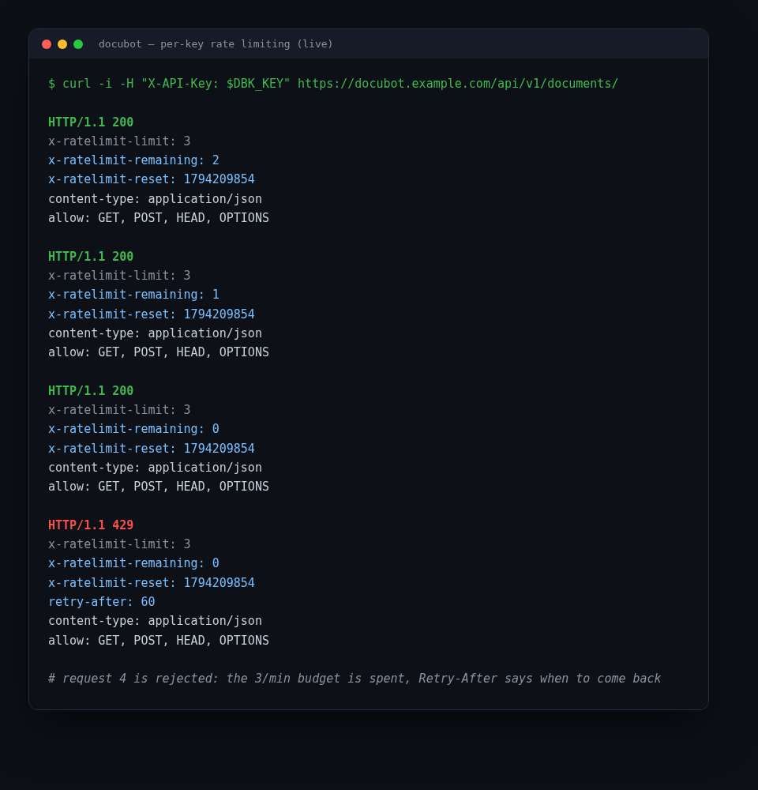

# API Reference

All endpoints live under `/api/v1/`. Interactive docs: `/api/docs/` (Swagger UI)
and `/api/schema/` (raw OpenAPI 3).

Endpoints accept a JWT access token (shown below) **or** a personal API
key (`X-API-Key` — see [API keys](#api-keys)):

```
Authorization: Bearer <access token>
```

Every list endpoint is paginated (`?page=` / `?page_size=`) and every queryset is
scoped to the authenticated user — other users' objects 404 like nonexistent ones.

## Authentication

| Method | Path | Description |
| --- | --- | --- |
| POST | `/api/v1/auth/register/` | Create an account |
| POST | `/api/v1/auth/login/` | Obtain access + refresh tokens |
| POST | `/api/v1/auth/refresh/` | Rotate the refresh token, get a new access token |
| GET  | `/api/v1/auth/me/` | Current user profile |

```bash
# Register
curl -X POST http://localhost:8000/api/v1/auth/register/ \
  -H 'Content-Type: application/json' \
  -d '{"username": "ada", "email": "ada@example.com", "password": "a-strong-passw0rd"}'

# Log in -> {"access": "...", "refresh": "..."}
curl -X POST http://localhost:8000/api/v1/auth/login/ \
  -H 'Content-Type: application/json' \
  -d '{"username": "ada", "password": "a-strong-passw0rd"}'

# Refresh (old refresh token is blacklisted — rotation is enforced)
curl -X POST http://localhost:8000/api/v1/auth/refresh/ \
  -H 'Content-Type: application/json' -d '{"refresh": "<refresh token>"}'
```

## API keys

Personal keys let scripts, CI and integrations call the API without handling
JWT rotation. Create one, copy the secret (shown **only once**), send it as a
header:

| Method | Path | Description |
| --- | --- | --- |
| GET | `/api/v1/keys/` | List my keys (masked, with usage counters) |
| POST | `/api/v1/keys/` | Create a key: `{"name": "ci", "scope": "write", "rate_limit": 60}` |
| POST | `/api/v1/keys/{id}/revoke/` | Revoke immediately (idempotent) |

```bash
KEY=$(curl -s -X POST http://localhost:8000/api/v1/keys/ \
  -H "Authorization: Bearer $ACCESS" -H 'Content-Type: application/json' \
  -d '{"name": "ci-bot", "scope": "write", "rate_limit": 3}' | jq -r .key)

curl http://localhost:8000/api/v1/documents/ -H "X-API-Key: $KEY"
```

Keys are stored **hashed** (SHA-256). `scope: read` may only issue safe
methods (GET/HEAD/OPTIONS); `scope: write` can upload, ask and delete.
Revocation takes effect immediately; listing never reveals the secret.

### Rate limiting and usage metering

Every key owns a **per-minute request budget**. Set `rate_limit` (1–10000)
at creation for a per-key cap, or leave it out to inherit
`APIKEY_RATE_LIMIT` (default 120/min, env-tunable). JWT traffic is never
metered by it. Every response to a key-authenticated request carries:

| Header | Meaning |
| --- | --- |
| `X-RateLimit-Limit` | the key's effective per-minute budget |
| `X-RateLimit-Remaining` | requests still available in this window |
| `X-RateLimit-Reset` | unix epoch at which the window frees up |
| `Retry-After` | on **429** only: seconds until the next allowed request |

The budget is a sliding 60-second window backed by Redis; once it is spent
the API answers `429 Too Many Requests` until the window rolls forward.
Each key also keeps a lifetime `request_count` (exposed in the keys listing
and ranked in the admin `/api/v1/stats/` payload as `top_keys`), so you can
see which integration is eating the traffic.



## Documents

| Method | Path | Description |
| --- | --- | --- |
| GET | `/api/v1/documents/` | List my documents (`?status=`, `?search=`, `?ordering=`) |
| POST | `/api/v1/documents/` | Upload PDF/TXT (`multipart/form-data`), returns **202** |
| GET | `/api/v1/documents/{id}/` | Inspect one document |
| DELETE | `/api/v1/documents/{id}/` | Delete document, chunks and stored file |
| POST | `/api/v1/documents/{id}/reprocess/` | Re-queue a **failed** document (409 otherwise) |

```bash
curl -X POST http://localhost:8000/api/v1/documents/ \
  -H "Authorization: Bearer $ACCESS" \
  -F "title=Product Handbook" \
  -F "file=@handbook.pdf"
```

Upload returns `202 Accepted` immediately; processing (extract → chunk → embed)
runs on Celery. Poll `status` until it leaves `pending`/`processing`:

| status | meaning |
| --- | --- |
| `pending` | queued, no worker picked it up yet |
| `processing` | extraction/embedding in progress |
| `ready` | chunks embedded and searchable |
| `failed` | see `error_message`; can be reprocessed |

## Search

```bash
curl -X POST http://localhost:8000/api/v1/search/ \
  -H "Authorization: Bearer $ACCESS" -H 'Content-Type: application/json' \
  -d '{"query": "clause 14.3.2b", "mode": "hybrid", "top_k": 5}'
```

| Field | Type | Notes |
| --- | --- | --- |
| `query` | string | required, ≤ `QUERY_MAX_LENGTH` (validated live) |
| `mode` | string | optional: `vector` (default) \| `keyword` \| `hybrid` |
| `top_k` | int | optional, 1…`RETRIEVAL_MAX_TOP_K` |
| `document_ids` | int[] | optional filter |

Response: ranked hits with `document_id`, `document_title`, `chunk_index`,
`page`, `content`, `score`, `match` (`vector`, `keyword` or `both`). Only the
caller's `ready` documents are ever searched.

**Retrieval modes**

| Mode | Signal | Best for |
| --- | --- | --- |
| `vector` | pgvector HNSW, cosine similarity | meaning (“time off rules”) |
| `keyword` | Postgres FTS over a generated `tsvector` (GIN) | literal terms: error codes, part numbers, names |
| `hybrid` | both, fused with Reciprocal Rank Fusion (k=60) | default for RAG answers — best recall |

Keyword queries accept websearch syntax: quote phrases (`"vacation policy"`),
exclude with a minus (`vacation -unpaid`).

## Chat

| Method | Path | Description |
| --- | --- | --- |
| GET | `/api/v1/conversations/` | My conversations (newest activity first) |
| POST | `/api/v1/conversations/` | Create `{ "title": "..." }` |
| GET | `/api/v1/conversations/{id}/messages/` | Chronological history |
| POST | `/api/v1/conversations/{id}/messages/` | Ask a question, get the full answer as JSON |
| POST | `/api/v1/conversations/{id}/messages/stream/` | Same turn, streamed as **SSE** |
| POST/DELETE | `/api/v1/conversations/{id}/messages/{mid}/feedback/` | Rate an answer 👍/👎 (or clear) |

JSON turn request: `{ "content": "...", "mode": "hybrid", "document_ids": [1, 2] }`
(content ≤ 2000 chars). Response `201`:

```json
{
  "id": 42,
  "role": "assistant",
  "content": "Reset it from Settings → Security [1].",
  "sources": [{"document_id": 7, "document_title": "Handbook", "chunk_index": 3, "page": 12, "score": 0.8123, "snippet": "…"}],
  "citations": [{"number": 1, "document_id": 7, "document_title": "Handbook", "page": 12, "snippet": "…"}],
  "rating": "",
  "rating_comment": "",
  "rated_at": null,
  "model": "gpt-4o-mini",
  "prompt_tokens": 412,
  "completion_tokens": 38,
  "created_at": "2026-11-05T10:00:00Z"
}
```

`citations` lists only the sources the answer actually referenced via `[n]`
markers, in first-mention order, each carrying the source `page` when known.
Follow-up questions are rewritten into standalone search queries before
retrieval (raw question is stored; `QUERY_REWRITE_ENABLED=0` disables).

### Streaming (Server-Sent Events)

`POST /conversations/{id}/messages/stream/` responds with
`Content-Type: text/event-stream` and emits, in order:

```
event: sources        data: {"sources": [{"document_id": 7, "page": 12, "snippet": "…"}]}   # once, first
event: delta          data: {"text": "Reset"}                   # repeated
event: delta          data: {"text": " it from…"}
event: done           data: {"message_id": 42, "content": "…", "sources": [...], "citations": [...]}
```

* `done` means the turn is persisted (user + assistant messages).
* On LLM failure: `event: error data: {"detail": "…"}` — nothing is persisted.
* Client disconnect: the partial answer is still persisted (`GeneratorExit` path).

```js
const es = new EventSource(`/api/v1/conversations/${id}/messages/stream/`, {
  method: "POST", headers: {Authorization: `Bearer ${token}`}, body: formData,
});
es.addEventListener("delta", (e) => append(JSON.parse(e.data).text));
```

(For browsers that can't set headers on `EventSource`, the demo UI posts with
`fetch` and reads the stream manually — see `static/demo/app.js`.)

## Health

| Method | Path | Description |
| --- | --- | --- |
| GET | `/api/v1/health/` | Liveness/readiness for orchestrators (no auth) |

`200` when all vital components are healthy:

```json
{"status": "ok", "django": "ok", "components": {"database": "ok", "cache": "ok", "celery": "ok"}}
```

* Database or cache failing → **503** with `status: "error"` (the service cannot work).
* Celery unreachable → still **200** with `components.celery: "degraded"` (uploads
  stall but the API is alive).
* Used by the Docker `HEALTHCHECK`, the worker healthcheck and the demo UI status dot.

## Rate limits

Writes are throttled per user (scoped buckets, only unsafe methods count):

| Scope | Endpoints | Default | Env override |
| --- | --- | --- | --- |
| `auth` | register / login / refresh | 30/min | `THROTTLE_AUTH` |
| `chat` | ask + stream | 60/min | `THROTTLE_CHAT` |
| `search` | semantic search | 60/min | `THROTTLE_SEARCH` |
| `upload` | document upload / reprocess | 60/hour | `THROTTLE_UPLOAD` |

Exceeding a bucket returns `429 Too Many Requests` with a `Retry-After` header.
Reads (GET/HEAD/OPTIONS) are never metered.

## Usage analytics (admin)

| Method | Path | Description |
| --- | --- | --- |
| GET | `/api/v1/stats/` | Aggregate usage stats (staff only) |

Returns users, documents by status, chunks, conversations, messages by role,
token totals, the 👍/👎 feedback ratio, API-key adoption and `activity_14d` —
a continuous per-day series of assistant messages over the last two weeks.
